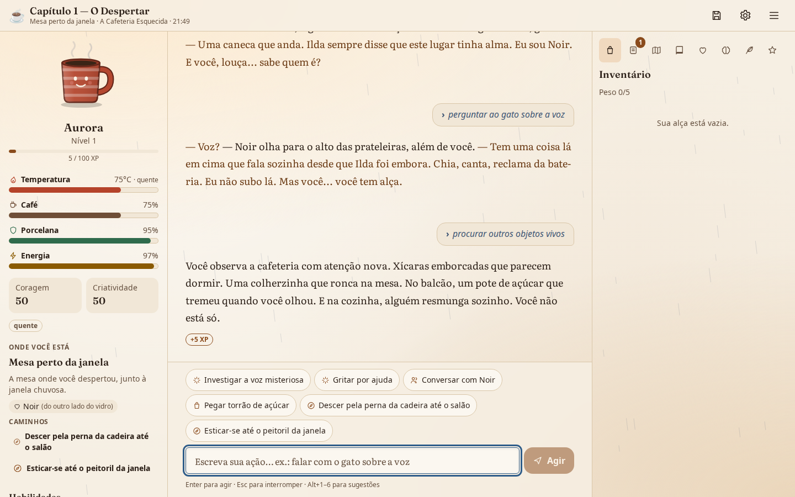
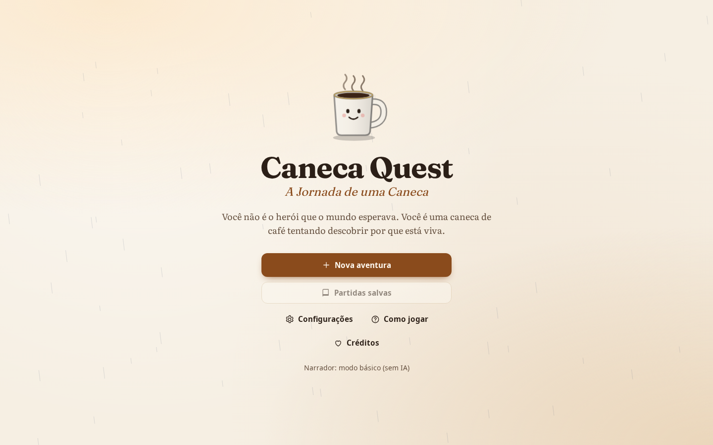
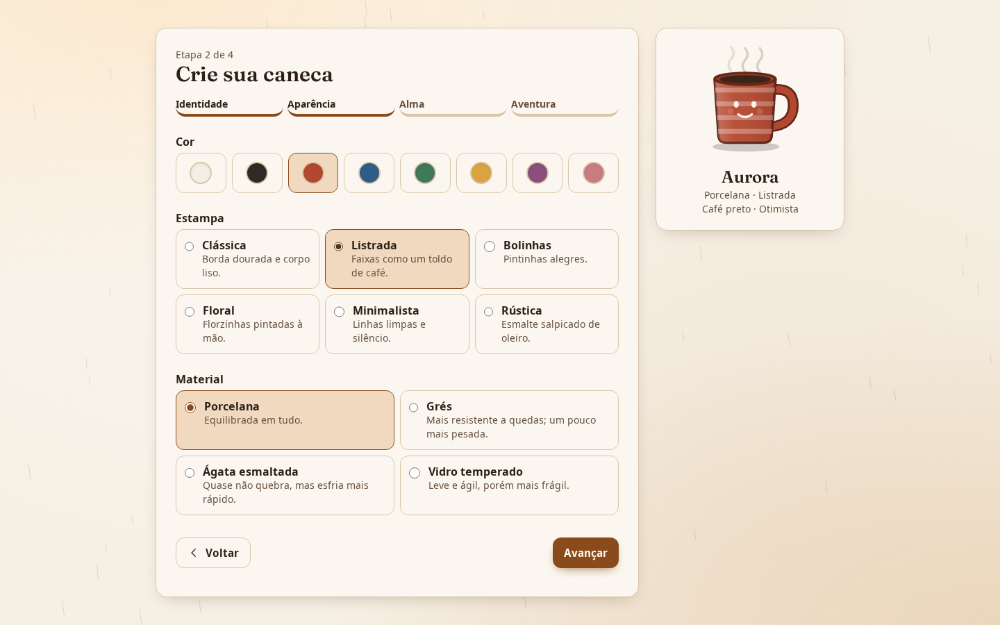
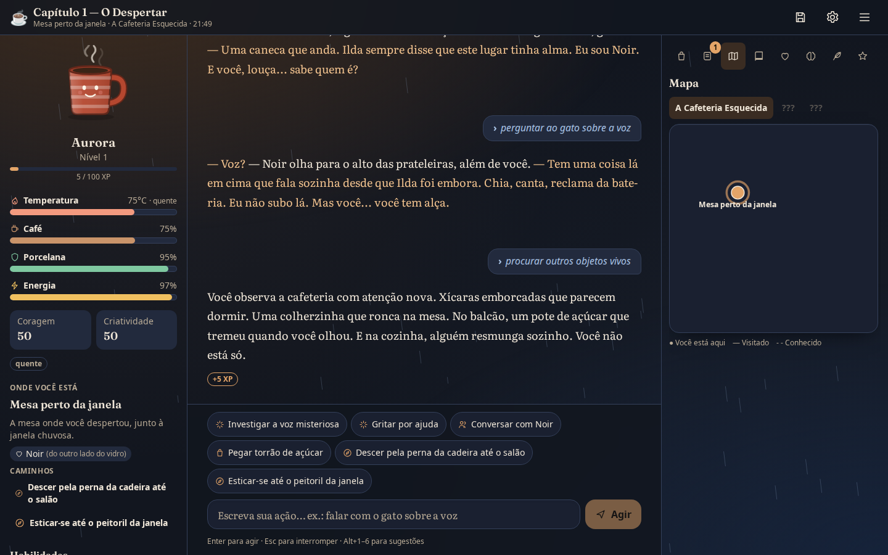
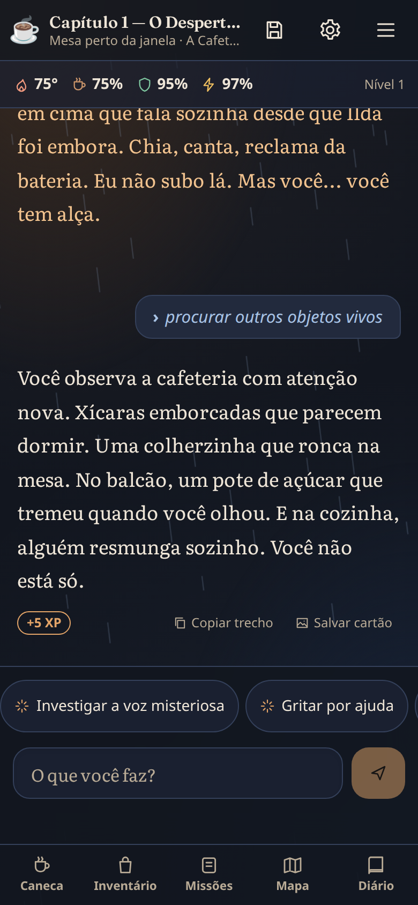

# ☕ Caneca Quest — A Jornada de uma Caneca

> *Você não é o herói que o mundo esperava. Você é uma caneca de café tentando descobrir por que está viva.*

**Caneca Quest** é um RPG narrativo de texto. Você é uma caneca de porcelana que desperta numa cafeteria abandonada, numa noite de chuva — e o mundo é visto da altura de um objeto pequeno: a mesa é uma planície, a pia é um abismo, uma poça é um oceano e um gato é um titã.

Você escreve o que quer fazer, com suas palavras. Um **motor de regras determinístico** decide o que acontece; uma **IA opcional** (local, via Ollama, ou em nuvem) narra o resultado e dá voz aos personagens. Sem IA, o jogo continua completo, com narrativa pré-escrita.



| Boas-vindas | Criação da caneca |
|---|---|
|  |  |

| Tema escuro com mapa | Celular |
|---|---|
|  |  |

*Capturas geradas automaticamente a partir do aplicativo real (`npm run screenshots -w @caneca/web`).*

---

## O que já funciona

**A história**
- Três regiões conectadas e completas: **A Cafeteria Esquecida**, **A Cidade Gigantesca** e **A Floresta dos Objetos Perdidos** — 23 locais, 13 personagens, 11 missões e 3 finais diferentes (mais a derrota, se a porcelana se partir).
- Liberdade real: comandos em texto livre em **português e inglês** ("quero pular da mesa", "derramar um pouco de café no moedor", "subir nas costas do gato"). As sugestões são só atalhos.
- Quebra-cabeças com várias soluções. Exemplos: sair da cafeteria pela portinhola com a ajuda do gato, pela janela ou laçando a maçaneta com um barbante; atravessar a poça derramando café para flutuar ou construindo um barquinho; cruzar a rua esperando o sinal, voando com o pombo ou montada no gato.
- Personagens com personalidade, histórico, objetivos, segredos, humor e relações que evoluem. Cada um **só sabe o que presenciou ou ouviu** — o motor registra quem testemunhou cada fato.
- Mundo persistente e coerente: o que você pega fica com você (é impossível duplicar itens), portas abertas continuam abertas, missões têm desfechos alternativos.

**O corpo de caneca**
- Temperatura (o café esfria pela lei de Newton e aquece perto do fogão), café (pode ser derramado; com pouco café você flutua), porcelana (quedas racham; rachada, você vaza), energia, coragem, criatividade, experiência e nível.
- Testes de dados com d20 + atributos, reproduzíveis por semente. Habilidades aprendidas com os personagens (salto de porcelana, camuflagem, percepção de vibrações, manipulação de vapor, regeneração…).
- Personalização: nome, cor, estampa, material, bebida, personalidade e traços — cada escolha tem efeito nas regras e aparece na ilustração da caneca.
- Tom da história (7 opções), dificuldade (História, Aventura, Sobrevivência) e tamanho da narração (curta → cinematográfica).

**A interface**
- Tela de jogo em três colunas no desktop, duas no tablet e narrativa em primeiro plano no celular, com painéis em folhas inferiores.
- Texto progressivo, falas destacadas, consequências visíveis (−3 °C, +item, relação +5), testes de dados opcionais, histórico navegável, atalhos de teclado.
- Oito painéis: inventário, missões, mapa, diário automático, relações, memórias, enciclopédia e conquistas.
- Temas claro, escuro e automático; contraste WCAG 2.2 AA verificado em teste; tamanho de texto, fonte de alta legibilidade e redução de movimento.
- Som ambiente gerado no próprio dispositivo (desligado por padrão) e modo narrador com leitura em voz alta (Web Speech).
- Partidas múltiplas, salvamento automático a cada turno, pontos salvos manuais e automáticos, restauração, exportação/importação validada e cópias de segurança.
- Instalável como **PWA** e empacotável como **app desktop** (Tauri).

## Arquitetura

```text
 Navegador / PWA / Tauri ──HTTP + SSE──► caneca-server (FastAPI)
 React 19 + TypeScript                     ├─ Motor de regras (Python, determinístico)
 Tailwind 4 + Zustand                      ├─ Conteúdo do mundo (YAML validado)
                                           ├─ SQLite (WAL) + SQLAlchemy + Alembic
                                           └─ Narrador ──► Ollama | OpenAI-compatível | Anthropic (opcional)
```

A regra central: **o motor decide, a IA narra.** Cada ação passa por interpretação → validação contra a cena → regras e testes → gravação transacional → só então narração. O texto da IA é tratado como dado não confiável: não altera estado, é limpo antes de ser exibido e, se falhar, o texto do motor é usado. Detalhes em [`docs/architecture/overview.md`](docs/architecture/overview.md) e [`docs/architecture/game-engine.md`](docs/architecture/game-engine.md).

## Requisitos

| Para | Precisa de |
|---|---|
| Jogar no navegador (desenvolvimento ou servidor local) | Python ≥ 3.11 com [uv](https://docs.astral.sh/uv/), Node.js ≥ 20.19 |
| IA local (opcional) | [Ollama](https://ollama.com) e um modelo instalado |
| Gerar o app desktop | Rust (stable) e as dependências de sistema do [Tauri 2](https://v2.tauri.app/start/prerequisites/) |

Não é preciso GPU: sem IA o jogo é instantâneo, e modelos pequenos do Ollama rodam em CPU (mais devagar).

## Instalação

### Linux (BigLinux, Manjaro e derivados do Arch)

```bash
sudo pacman -S --needed python nodejs npm git
curl -LsSf https://astral.sh/uv/install.sh | sh     # ou: sudo pacman -S uv
git clone <url-do-repositório> caneca-quest && cd caneca-quest
cd backend && uv sync && cd ..
npm install
```

Em Debian/Ubuntu, troque a primeira linha por `sudo apt install python3 nodejs npm git` (use Node ≥ 20.19).

### Windows

1. Instale [Python 3.11+](https://www.python.org/downloads/), [Node.js LTS](https://nodejs.org) e [Git](https://git-scm.com).
2. No PowerShell: `powershell -ExecutionPolicy ByPass -c "irm https://astral.sh/uv/install.ps1 | iex"`
3. Depois:
   ```powershell
   git clone <url-do-repositório> caneca-quest; cd caneca-quest
   cd backend; uv sync; cd ..
   npm install
   ```

### macOS

```bash
brew install python node uv git
git clone <url-do-repositório> caneca-quest && cd caneca-quest
cd backend && uv sync && cd ..
npm install
```

> O jogo foi desenvolvido e testado no Linux (BigLinux/Manjaro). Os passos de Windows e macOS seguem a documentação oficial das ferramentas, mas **não foram executados nessas plataformas** ainda.

## Como jogar

### Opção 1 — um único servidor (recomendado para jogar)

```bash
npm run build:web                                            # gera apps/web/dist
cd backend && uv run caneca-server --static-dir ../apps/web/dist
```

Abra **http://127.0.0.1:8765**. No navegador, use "Instalar app" para tê-lo como PWA. Os dados ficam em `~/.local/share/caneca-quest` (Linux), `%APPDATA%\CanecaQuest` (Windows) ou `~/Library/Application Support/CanecaQuest` (macOS).

### Opção 2 — desenvolvimento (recarregamento automático)

```bash
# terminal 1 — backend em :8765
cd backend && uv run caneca-server

# terminal 2 — interface em :5173 (com proxy para a API)
npm run dev:web
```

Abra **http://localhost:5173**.

## Modos de narração

### Modo básico (sem IA)

É o padrão. Toda a aventura — os três capítulos, diálogos, quebra-cabeças e finais — tem texto pré-escrito em português e inglês. O interpretador de comandos entende frases livres, e o jogo funciona offline. A interface identifica o modo ("Narrador: modo básico").

### IA local com Ollama

1. Instale o Ollama: Linux `curl -fsSL https://ollama.com/install.sh | sh` (no Manjaro/BigLinux também `sudo pacman -S ollama` e `sudo systemctl enable --now ollama`); Windows e macOS pelo instalador em [ollama.com](https://ollama.com).
2. Baixe um modelo. Sugestões: `ollama pull llama3.2` (≈ 2 GB, roda em CPU) ou `ollama pull qwen2.5:7b` (melhor em português, pede mais memória).
3. No jogo: **Configurações → Inteligência artificial → Ollama (IA local)** → "Verificar e listar modelos" → escolha o modelo → **Testar** → **Salvar**.

O jogo detecta se o Ollama está no ar, lista os modelos instalados, avisa quando nenhum está disponível, permite ajustar endereço, temperatura, janela de contexto e tempo limite, transmite a narração em tempo real e deixa interromper a geração (Esc). Se o modelo falhar ou demorar demais, o turno já está salvo e o texto do motor é usado.

> O adaptador do Ollama foi testado contra um servidor simulado que reproduz o protocolo da API (NDJSON). **Não houve teste com um Ollama real neste ambiente**; a qualidade da narração depende do modelo escolhido.

### IA em nuvem

Provedores compatíveis com a API da OpenAI (OpenAI, OpenRouter, Groq, LM Studio, vLLM…) e Anthropic. Em **Configurações → Inteligência artificial**, escolha o provedor, cole a chave e marque o consentimento — o jogo avisa que o texto da aventura será enviado a um serviço externo, que pode cobrar pelo uso. Sem esse consentimento, nada sai do seu computador.

As chaves ficam só no servidor local (`secrets.json` com permissão 0600 na pasta de dados) ou em variáveis de ambiente (`CANECA_OPENAI_API_KEY`, `CANECA_ANTHROPIC_API_KEY`) e **nunca são enviadas ao navegador**. O consumo de tokens por provedor e modelo aparece nas configurações. Veja [`docs/ai/providers.md`](docs/ai/providers.md).

## Testes

```bash
# Backend: pytest, lint e tipos
cd backend
uv run pytest
uv run ruff check caneca tests scripts && uv run ruff format --check caneca tests scripts
uv run mypy caneca

# Frontend: tipos, lint e testes de unidade/componentes
npm run typecheck -w @caneca/web && npm run lint:web && npm run test:web

# Ponta a ponta (sobe o backend real sozinho, com dados temporários)
npx playwright install chromium        # uma vez
npm run build:web && npm run e2e
```

Na última execução: **201 testes de backend**, **94 de frontend** e **11 cenários E2E** passaram (desktop e celular, temas claro e escuro, teclado, persistência, falha de rede e auditoria de acessibilidade com axe). Medições de desempenho reais estão em [`docs/testing/performance.md`](docs/testing/performance.md) — por exemplo, um turno completo pela API leva 11 ms no p95 sem IA. O plano completo está em [`docs/testing/test-plan.md`](docs/testing/test-plan.md).

## Builds

| Alvo | Comando | Estado |
|---|---|---|
| Web/PWA | `npm run build:web` → `apps/web/dist` | ✅ gerado e testado |
| Desktop Linux (`.deb`, `.rpm`, AppImage) | ver abaixo | ✅ `.deb` gerado e app executado no Linux |
| Desktop Windows (`.msi`/NSIS) e macOS (`.dmg`) | `release.yml` no GitHub Actions | ⚠️ configurado, ainda não executado |

```bash
# 1. empacota o backend como executável único (PyInstaller)
npm run sidecar -w @caneca/desktop
# 2. compila a interface
npm run build:web
# 3. gera os instaladores (Linux: requer webkit2gtk-4.1, ver pré-requisitos do Tauri)
cd apps/desktop && npx tauri build --bundles deb    # ou rpm, appimage
```

O app desktop sobe o backend numa porta aleatória de `127.0.0.1` com um token secreto por execução, não concede nenhuma permissão de IPC à interface e encerra o servidor mesmo se for fechado à força. Detalhes em [`docs/security/threat-model.md`](docs/security/threat-model.md).

## Estrutura do projeto

```text
caneca-quest/
├── backend/                 FastAPI + motor de regras (Python)
│   ├── caneca/
│   │   ├── game/            motor, parser, regras, estado, conteúdo YAML (content/)
│   │   ├── ai/              prompts, provedores, orquestração, segurança da saída
│   │   ├── memory/          seleção de memória com orçamento de contexto
│   │   ├── persistence/     SQLite, ORM, migrações Alembic, backups
│   │   ├── services/        pipeline de turno, saves, import/export
│   │   └── api/             rotas REST + SSE, views, segurança HTTP
│   ├── scripts/bench.py     medições de desempenho
│   └── tests/
├── apps/
│   ├── web/                 React + TypeScript + Vite + Tailwind (PWA) e testes E2E
│   └── desktop/             Tauri 2 (Rust) com o backend como sidecar
├── docs/                    arquitetura, IA, design, narrativa, segurança, testes, agentes
├── scripts/                 build do sidecar
├── .github/workflows/       CI e builds de release
├── AGENTS.md                guia para pessoas e agentes de IA que trabalham no código
└── README.md
```

## Como contribuir

1. Leia o [`AGENTS.md`](AGENTS.md): padrões de código, comandos e critérios de qualidade.
2. Novos lugares, personagens e missões são **dados**, não código: edite os YAML em `backend/caneca/game/content/` (o carregador valida todas as referências) e adicione um teste de história.
3. Todo texto de interface entra pelas chaves de `apps/web/src/i18n/` — em português e inglês.
4. Antes de abrir um PR, rode os testes e lints acima. Use [Conventional Commits](https://www.conventionalcommits.org/pt-br/) (`feat:`, `fix:`, `docs:`…).

A bíblia do mundo e os roteiros dos capítulos estão em [`docs/narrative/`](docs/narrative/).

## Roadmap

O que está feito e o que vem a seguir, sem enfeite, está em [`docs/roadmap.md`](docs/roadmap.md). Próximos passos: validar os instaladores de Windows e macOS, testar com Ollama real em hardware modesto, controle de custos para provedores em nuvem, ilustrações por local, TTS local e geração procedural de lugares dentro das regras do mundo.

## Licença

Código sob a licença [MIT](LICENSE). Narrativa, ilustrações vetoriais e sons procedurais são originais do projeto. Fontes: Fraunces, Literata e Atkinson Hyperlegible, sob a SIL Open Font License.
